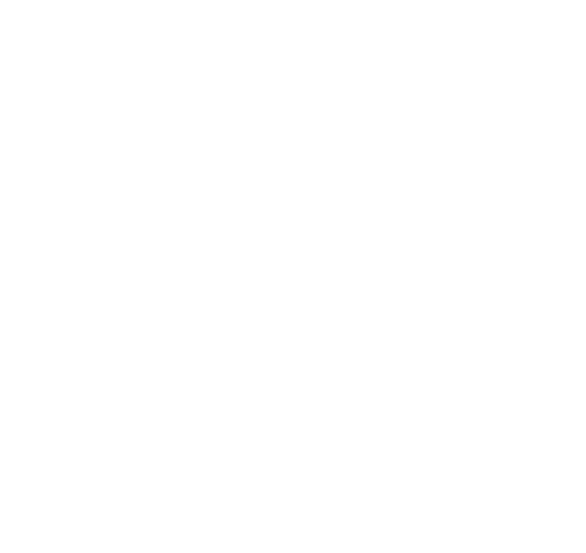
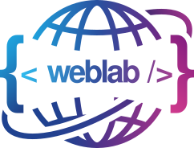

<div align="center">
  <br />
  
  
  <br />
  
  # SKY LAB
  **Yıldız Technical University Computer Science Club**

  <a href="https://yildizskylab.com" target="_blank">
    
  </a>

  <br />
  <br />

  <p>
    
    
    
    
  </p>

  ---

  <p align="center" style="max-width: 600px;">
    <i>The official SKY LAB website — presenting the club’s identity, teams, and projects with a modern, fast, and mobile-friendly experience.</i>
  </p>

  <br />

  <p align="center">
    <kbd>Developed by</kbd> <br />
    <br />
    
  </p>
</div>

## Local development

```bash
npm install
npm run dev   # http://localhost:3000
```

Local development runs against the **sandbox**, never the production API or realm. `.env.local`:

```env
# The CMS through `npm run dev`'s proxy to the sandbox API (next.config.ts, `next dev` only):
# the editor in the browser only talks to localhost, since the edge does not let
# http://localhost:3000 call the club's hosts cross-origin. Change the port with the dev server's.
CMS_URL=http://localhost:3000/sandbox-api/api
# Core, for the CMS image bridge (server to server)
API_BASE_URL=https://sandbox-api.yildizskylab.com
KEYCLOAK_ISSUER=https://e.yildizskylab.com/realms/e-skylab-sandbox
KEYCLOAK_CLIENT_ID=frontend-main
KEYCLOAK_CLIENT_SECRET=
NEXTAUTH_URL=http://localhost:3000
# openssl rand -base64 32
NEXTAUTH_SECRET=
```

Without `CMS_URL` the server reads the sandbox CMS directly, which is enough for the public pages. The sandbox `frontend-main` client does not accept a localhost redirect URI, so the editor is tried on https://sandbox.yildizskylab.com. The deployed values come from the image build (`.github/workflows/ghcr.yml`) and Dokploy.

## Door check-in (`/kapi/[sessionId]`)

A guest without an account checks in to an event Session at the door. The door screen shows a QR that core signs and replaces every 15 seconds; it opens `/kapi/<sessionId>?dq=<token>`. The page asks for the e-mail of the guest's registration and posts `{email, doorToken}` from the browser to core's `POST /v1/sessions/{sessionId}/check-in/guest` (contract: core-backend `docs/guest-self-check-in.md`).

- Core's origin is `API_BASE_URL` from the image build (`CORE_API_ORIGIN`, next.config.ts); `npm run dev` sends the check-in through the `/sandbox-api` proxy instead.
- The call goes from the browser, not through this site's server, because core limits failed attempts per client address: through a server every guest would share one address. The edge's CORS (`cors-pub`) allows `https://yildizskylab.com` and `https://sandbox.yildizskylab.com`.
- The page is `noindex`, sends no Referer, keeps the e-mail only in memory and takes `dq` out of the address bar after it loads.
- Core builds the QR's address from `DOOR_QR_GUEST_URL` (core's environment): `https://yildizskylab.com/kapi/{sessionId}` in production, `https://sandbox.yildizskylab.com/kapi/{sessionId}` in the sandbox.

## Ticket page (`/bilet/[key]`)

The ticket a person gets in the "Biletin hazır" mail (ADR 0082 in skylab-kulubu/e-skylab). It opens without a sign-in: the access key in the address is the right to read, since a guest has no account.

- The server reads core's `GET /v1/public/tickets/{key}` (contract: core-backend `docs/ticket-page.md`) with `cache: "no-store"`. A key that is not 26 characters of `A`–`Z` and `2`–`7` is "Bilet bulunamadı" without asking core. `404` → not found, `410 ticket_page_closed` (a week after the Event) → "Bu bilet artık açık değil.", anything else → "Bilet şu an açılamıyor".
- The card's front is the Event's cover (`coverImageUrl` when core sends it, else a plain card) with its name and date; a tap turns it to the back: organizer, name, date and hours, place, the holder, the QR (core's `qrUrl`), the code, "PDF’i indir" (`pdfUrl`) and "Haritada aç". A tap on the QR shows it full screen and keeps the screen awake. From three hours before the Event until its end the card opens on its back.
- The card's colour is `ticketAccentColor`, else core's `theme.accent`, else the cover's first colour (`coverColors[0]`), else the club's purple, darkened until white text reads at 4.5:1. The cover loads only from the club's media hosts (`cdn.`, `sandbox-cdn.yildizskylab.com`) or core; any other host leaves the card without one.
- Core limits the ticket's routes per client, and the page asks core from this site's server, so the request carries the visitor's address as `X-Forwarded-For`: the last entry of the `X-Forwarded-For` Traefik wrote (else `X-Real-Ip`), only when it is an IP address. `CF-Connecting-IP` is not read: the site is not behind Cloudflare, so a visitor could write it. Core believes the header only from the site's internal address, so the server asks core over the internal network when `CORE_INTERNAL_URL` is set (run time, server only, optional; e.g. `http://sky-lab-production-core-8qn0in:8080` in production, `http://sky-lab-sandbox-core-ljnbrl:8080` in the sandbox). Unset, it asks the public origin as before and the header has no effect. The QR and PDF links the browser follows stay on core's public origin.
- The card floats a few pixels while its front shows; it stands still whenever the QR is in view and never moves with reduced motion.
- `noindex` and no Referer (next.config.ts), the key never logged and never shown back on an error.
- After a turn, focus moves to the face in view and a polite live region says which face it is.
- Core's origin is `API_BASE_URL` from the image build (`CORE_API_ORIGIN`), as for `/sertifika`. Locally, point `API_BASE_URL` at a core of your own (or a stand-in) and open `/bilet/<key>`.

## skylcn-ui pages (`/kapi`, `/sertifika`, `/bilet`)

The door check-in, the certificate check and the ticket are drawn with [skylcn-ui](https://github.com/skylab-kulubu/skylcn-ui), the club's design system (ADR 0055 in skylab-kulubu/e-skylab). The rest of the site is not, and stays exactly as it is:

- Only `src/components/skylcn/SkylcnScope.tsx` loads skylcn-ui's theme (`skylcn-scope.css`) and the Space Grotesk and Space Mono fonts; the routes' `layout.tsx` render it. `globals.css` does not import skylcn-ui, since its theme sets the same tokens (`--background`, `--border`, `--radius`…) and base styles on `:root`.
- These pages use no `next/link`: a stylesheet stays in the document after a client-side navigation, so leaving them is a full page load. `test/skylcn-scope.test.mjs` guards both rules.
- These pages are always dark, like the rest of the site, which has no theme switch: `SkylcnScope` fixes `data-theme="dark"` on its wrapper and renders no `ThemeScript`, so a light choice (`skylcn:theme`) made in another skylcn-ui product does not apply here.
